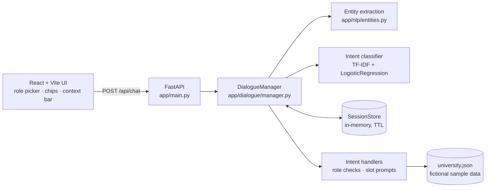

# AI Chatbot for Student Portal

> This is a 2026 rebuild of my B.Tech final-year project (Amrita Vishwa Vidyapeetham), rewritten from scratch with a cleaner architecture.

A university help-desk chatbot for a fictional **Example University**. It answers academic queries (exams, timetables, results, attendance), admissions questions (eligibility, deadlines, fees, documents), course details and campus services (library, hostel, transport, canteen, Wi-Fi, health centre). It does this with **NLP intent classification**, **role-based response flows** for students, faculty and administrators, and **context-aware multi-turn dialogue**.

**Stack:** Python 3.12 · scikit-learn · FastAPI · React 19 + Vite + TypeScript

```text
You:  What's the exam schedule for CSE?
Bot:  End-semester examinations, November-December 2026 for Computer Science and Engineering:
      • Semester 1: Mon 23 Nov 2026 to Tue 1 Dec 2026 (4 papers)
      • Semester 3: ...
You:  and for ECE?                      <- follow-up: reuses the exam_schedule intent
Bot:  ... for Electronics and Communication Engineering: ...
You:  what about semester 5?            <- keeps department = ECE, adds semester = 5
Bot:  ECE semester 5 end-semester exams:
      • Mon 23 Nov 2026: EC501 Digital Signal Processing (FN (09:30-12:30)) ...
You:  show the timetable                <- new intent, remembered slots carry over
Bot:  ECE semester 5 weekly timetable: ...
```

## Features

- **Intent classification:** TF-IDF word (1-2) and character (2-5) n-grams feed a logistic regression classifier, trained on 1,165 hand-written phrases across 25 intents.
- **Confidence threshold:** predictions below 0.40 get a "didn't understand" reply with "did you mean" chips built from the model's next-best guesses. Clearly out-of-scope questions ("tell me a joke") are classified as `fallback` and politely declined.
- **Entity and slot extraction:** rules pick out department (`CSE`, "computer science", "electronics"...), semester ("sem 5", "5th semester", "semester five"), course code (`CS501`, "cs 501") and programme (B.Tech, M.Tech, MBA, Ph.D.). Before classification these entities are masked to placeholder words, so the model learns "exam schedule for *department*" rather than memorising department names.
- **Role-based flows:**
  - The same intent answers differently per role. For example, *attendance* gives a student their per-course record, gives faculty their class averages, and gives admins department-wide shortfall counts.
  - Some intents are restricted. Grade submission and leave requests are faculty-only; admission statistics and publishing notices are admin-only.
- **Multi-turn context:** per-session state keeps the last intent and remembered slots. Follow-ups such as "and for ECE?" or "what about semester 5?" continue the previous topic. When a required slot is missing the bot asks a clarification question and offers chips for the answer.
- **Chat UI:** role picker, typing indicator, suggestion chips, a "Remembering: Dept ECE · Sem 5" context bar and an optional NLP-details view (intent, confidence, how the turn was resolved). Works at phone width, in light and dark mode.

## Architecture



Each turn goes through these steps:

1. **Extract entities** from the message (department, semester, course code, programme).
2. **Classify the intent.** The message is normalised and its entities masked, then the classifier returns a ranked list of intents with probabilities.
3. **Resolve against context** (`DialogueManager._resolve`):
   - If the bot asked a clarification question and the message supplies that slot, it answers the pending question (`clarification`).
   - If the message is a bare follow-up (only entities plus filler words like "and for", "what about"), or the classifier is unsure, and the entities fit the last intent, the last topic continues (`follow_up`).
   - Otherwise, if confidence is below the threshold or the prediction is `fallback`, the bot sends the fallback reply.
   - Otherwise it uses the classifier's prediction (`classifier`).
4. **Check the role.** Restricted intents get a polite refusal plus suggestions for that role (`restricted`).
5. **Merge the slots into session memory.** A newly mentioned department or semester clears a stale course code.
6. **Run the handler.** It either answers using the dataset or asks for a missing slot.

## Model results

These are the real numbers from `python -m app.nlp.train`, also saved in [`models/metrics.json`](models/metrics.json) and [`models/classification_report.txt`](models/classification_report.txt).

| Metric | Value |
| --- | --- |
| Intents | 25 |
| Training phrases | 1,165 (hand-written) |
| Held-out test split | 233 phrases (stratified 20%, `random_state=42`) |
| **Test accuracy** | **95.7%** |
| Test macro-F1 | 0.959 |
| 5-fold stratified CV accuracy | 91.9% ± 1.1% |
| Correct test predictions above the 0.40 threshold | 92.8% |
| Wrong test predictions caught by the threshold (sent to fallback) | 70.0% |

These are the weakest classes on the test split, by F1 score:

| Intent | Precision | Recall | F1 |
| --- | --- | --- | --- |
| goodbye | 1.000 | 0.778 | 0.875 |
| admission_documents | 0.800 | 1.000 | 0.889 |
| fallback | 0.867 | 0.929 | 0.897 |
| medical | 1.000 | 0.818 | 0.900 |
| results | 1.000 | 0.818 | 0.900 |

About these numbers:

- The test split is small (8 to 14 phrases per intent), so the held-out figure is noisy. The cross-validation score is the more conservative estimate.
- The metrics come from a model fit on the training split only. The model shipped in `models/` is then refit on all 1,165 phrases.
- I compared other models with 5-fold CV: LinearSVC, word-only features and char-only features all scored between 88.9% and 92.1%. More training data mattered far more than the model choice; going from about 620 to 1,165 phrases raised CV accuracy from 76.9% to 91.9%. I kept logistic regression because the confidence threshold needs calibrated probabilities.

## Getting started

### Backend (Python 3.12)

```bash
python3.12 -m venv .venv
source .venv/bin/activate
pip install -r requirements.txt

python -m app.nlp.train            # optional: retrain (a trained model is already in models/)
uvicorn app.main:app --reload      # http://127.0.0.1:8000  ·  docs at /docs
```

### Frontend (tested with Node 26)

```bash
cd frontend
npm install
npm run dev                        # http://localhost:5173 (proxies /api to :8000)
npm run build                      # production build into frontend/dist
```

### Tests

```bash
pytest
```

There are 59 tests covering:

- **Classifier:** held-out accuracy must be at least 90%, plus checks on unseen phrasings.
- **Entity extraction and follow-up detection.**
- **Roles:** role restrictions and role-specific replies.
- **Multi-turn context:** slot carry-over, clarification flow, session isolation and expiry.
- **API:** the HTTP endpoints via FastAPI's `TestClient`, including validation and CORS.

## API

### `POST /api/chat`

| Field | Type | Notes |
| --- | --- | --- |
| `session_id` | string (1-64) | Any client-generated id; the frontend uses a UUID |
| `role` | `student` \| `faculty` \| `administrator` | Changing role starts a fresh session |
| `message` | string (1-500) | |

A two-turn conversation captured from a live `uvicorn` run:

```bash
$ curl -s -X POST localhost:8000/api/chat -H 'Content-Type: application/json' \
    -d '{"session_id": "demo-1", "role": "student", "message": "What is the exam schedule for CSE?"}'
{
    "reply": "End-semester examinations, November-December 2026 for Computer Science and Engineering:\n• Semester 1: Mon 23 Nov 2026 to Tue 1 Dec 2026 (4 papers)\n• Semester 3: Tue 24 Nov 2026 to Mon 30 Nov 2026 (3 papers)\n• Semester 5: Mon 23 Nov 2026 to Fri 27 Nov 2026 (3 papers)\n• Semester 7: Tue 24 Nov 2026 to Mon 30 Nov 2026 (3 papers)\n\nAsk about a semester for the full date sheet.\nHall tickets are available on the portal from Mon 16 Nov 2026.",
    "intent": "exam_schedule",
    "confidence": 0.981,
    "suggestions": ["What about semester 5?", "What about semester 3?", "And for ECE?"],
    "slots": {"department": "CSE"},
    "resolved_by": "classifier"
}

$ curl -s -X POST localhost:8000/api/chat -H 'Content-Type: application/json' \
    -d '{"session_id": "demo-1", "role": "student", "message": "and for ECE semester 5?"}'
{
    "reply": "ECE semester 5 end-semester exams:\n• Mon 23 Nov 2026: EC501 Digital Signal Processing (FN (09:30-12:30))\n• Wed 25 Nov 2026: EC502 Analog Communication (FN (09:30-12:30))\n• Fri 27 Nov 2026: EC503 Microprocessors and Microcontrollers (FN (09:30-12:30))\n\nHall tickets are available on the portal from Mon 16 Nov 2026.",
    "intent": "exam_schedule",
    "confidence": 0.981,
    "suggestions": ["And for CSE?", "Timetable for ECE semester 5"],
    "slots": {"department": "ECE", "semester": 5},
    "resolved_by": "follow_up"
}
```

The response always has `reply`, `intent`, `confidence` and `suggestions`, plus two extras:

- `slots`: what the bot is currently remembering for the session.
- `resolved_by`: how the turn was resolved (`classifier`, `follow_up`, `clarification`, `fallback` or `restricted`).

For a follow-up turn, `confidence` is the score of the turn that originally set the topic.

### `GET /api/health`

```json
{"status": "ok", "model_loaded": true, "intents": 25, "active_sessions": 0}
```

### Configuration

| Env var | Default | Purpose |
| --- | --- | --- |
| `CONFIDENCE_THRESHOLD` | `0.40` | Minimum probability before falling back |
| `CORS_ORIGINS` | `http://localhost:5173,http://127.0.0.1:5173` | Comma-separated allowed origins |
| `SESSION_TTL_SECONDS` | `1800` | Idle time before a session is forgotten |
| `MAX_SESSIONS` | `10000` | In-memory session cap (least recently used are evicted) |

No API keys or external services are needed.

## Project structure

```text
student-portal-ai-chatbot/
├── app/
│   ├── main.py                 # FastAPI app, routes, CORS, model loading
│   ├── config.py               # paths, threshold, session and CORS settings
│   ├── schemas.py              # Pydantic request/response models
│   ├── nlp/
│   │   ├── entities.py         # department / semester / course code / programme extraction + masking
│   │   ├── preprocess.py       # normalisation, follow-up detection
│   │   ├── classifier.py       # TF-IDF + LogisticRegression pipeline wrapper
│   │   └── train.py            # python -m app.nlp.train: evaluate, report, save
│   ├── dialogue/
│   │   ├── manager.py          # turn resolution: classifier vs follow-up vs clarification vs fallback
│   │   ├── handlers.py         # one handler per intent, with role access and slot prompts
│   │   ├── state.py            # DialogueState + thread-safe TTL SessionStore
│   │   ├── roles.py            # student / faculty / administrator
│   │   └── knowledge.py        # cached access to the JSON data
│   └── data/
│       ├── intents.json        # 25 intents, 1,165 training phrases, suggestion text
│       └── university.json     # fictional Example University: courses, exams, timetables, admissions, services
├── models/                     # trained model, metrics.json, classification_report.txt
├── tests/                      # pytest: NLP, dialogue/roles/context, API
├── frontend/
│   ├── src/
│   │   ├── App.tsx             # chat state, session handling, role switching
│   │   ├── api.ts
│   │   ├── components/         # RoleSelector, MessageList, MessageBubble, TypingIndicator, SuggestionChips, ContextBar, Composer
│   │   └── styles.css
│   └── vite.config.ts          # /api proxy to :8000
├── requirements.txt
└── pyproject.toml              # pytest config
```

## Design notes and limitations

- **Sample data only.** Example University and everyone in it (Demo Student, Demo Faculty, Demo Admin) are fictional. "Personal" answers such as attendance and CGPA come from one demo profile per role; there is no authentication, and the role picker stands in for a real login.
- **Classical NLP on purpose.** The original project was an intent-classification chatbot, and the rebuild keeps that approach. It is fast, explainable, runs offline and needs no API keys. The trade-off is brittleness on phrasings unlike the training data.
- **Bag-of-n-grams limits.** Word-level cues can override meaning. For example, "how much is the hostel fee" is classified as `admission_fees` rather than `hostel`, and "I lost my ID card" goes to `results` because "my" strongly signals personal-record intents. More training data or a sentence-embedding model would help.
- **In-memory sessions.** State lives in process memory, so it is lost on restart and not shared across workers. Moving to Redis would be the next step for a real deployment.

## License

[MIT](LICENSE) © 2026 Prajay Reddy
